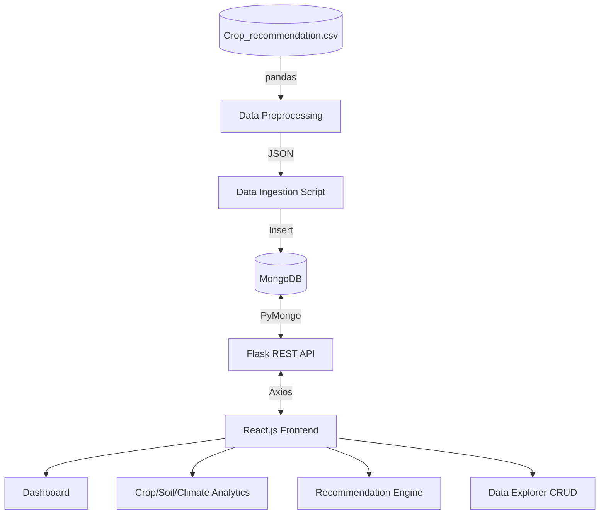

# AgriSense 🌾
**Agricultural Crop & Soil Analytics and Recommendation System Using MongoDB**

AgriSense is a full-stack, data-driven web application built for a **Big Data Analytics (BDA)** mini-project. It analyses soil nutrients (Nitrogen, Phosphorus, Potassium), climate conditions (Temperature, Humidity, Rainfall), and pH levels across 22 different crops to uncover agricultural insights. 

Crucially, AgriSense features a **Rule/Similarity-Based Crop Recommendation Engine** built entirely without Machine Learning, relying strictly on MongoDB Aggregation Pipelines and Euclidean distance-like normalisation to rank crops based on historical datasets.

This project aligns with the United Nations Sustainable Development Goals:
* **SDG 2 — Zero Hunger:** Promoting sustainable agriculture and optimal crop selection.
* **SDG 12 — Responsible Consumption and Production:** Data-driven resource allocation.

---

## 🏗️ Architecture & Technology Stack

AgriSense separates concerns cleanly between a fast React frontend, a robust Python backend, and a NoSQL data layer optimized for analytical queries.

* **Frontend:** React.js, Vite, Tailwind CSS, Recharts, Lucide Icons.
* **Backend:** Python 3, Flask, Flask-CORS, PyMongo, Pandas (for preprocessing).
* **Database:** MongoDB (NoSQL) utilizing extensive Aggregation Pipelines and Indexing.



---

## ✨ Key Features & MongoDB Concepts Applied

### 1. NoSQL Data Ingestion & Preprocessing
* Automated Python scripts (`preprocess_data.py` and `import_data.py`) use Pandas to clean data, fix validation ranges (e.g. Potassium max 210), and securely ingest 2,200 records into MongoDB while preventing duplicates.

### 2. MongoDB Aggregation Pipelines
Instead of calculating averages and distributions in Python, the project heavily leverages MongoDB Aggregations (`$group`, `$match`, `$project`, `$sort`) for Data Analytics:
* Crop distribution counts.
* Average N/P/K and Climate stats per crop.
* Soil pH categorization (Acidic, Neutral, Alkaline).
* Finding the min/max/avg boundaries for specific crop profiles.

### 3. MongoDB Indexing
To simulate high-performance data querying, MongoDB indexes are explicitly created during ingestion:
* `{ crop: 1 }` — Speeds up exact crop lookups and filtering.
* `{ ph: 1 }` — Speeds up queries searching by pH bounds.
* `{ rainfall: 1 }` & `{ temperature: 1 }` — Improves climate-based sorting and filtering.

### 4. Similarity-Based Crop Recommendation (No-ML)
A custom algorithm that calculates a **Dataset Similarity Score** across all 7 parameters. It fetches crop averages via aggregation, calculates normalized per-parameter similarity against the user's inputs based on the dataset's maximum spread, applies equal weighting (1/7), and ranks crops.

### 5. Full REST API & CRUD
Complete create, read, update, and delete capability integrated into the "Data Explorer", featuring server-side pagination, sorting, and advanced multi-parameter filtering.

---

## 🚀 How to Run the Project

### Prerequisites
* **Node.js** (v22+)
* **Python** (v3.13+)
* **MongoDB** (Running locally on default port `27017` or update `.env`)

### 1. Database Setup & Data Ingestion
Open a terminal and navigate to the `backend` folder:
```powershell
cd backend
python -m venv venv
.\venv\Scripts\activate   # Windows
# source venv/bin/activate # Mac/Linux

pip install -r requirements.txt

# Run the data processing and ingestion pipeline
python scripts\preprocess_data.py
python scripts\import_data.py
```

### 2. Start the Backend API (Flask)
```powershell
# While in the backend folder with venv activated
python app.py
```
*The API will start at `http://localhost:5000`*

### 3. Start the Frontend (Vite)
Open a *new* terminal and navigate to the `frontend` folder:
```powershell
cd frontend
npm install
npm run dev
```
*The web app will start at `http://localhost:5173`*

---

## 🧪 Testing

The backend includes a comprehensive unit test suite covering Health Checks, Data Validation, Analytics Endpoints, and the Recommendation algorithm.

To run the tests:
```powershell
cd backend
.\venv\Scripts\activate
python -m unittest tests/test_api.py -v
```

---

## 📁 Directory Structure
```
agriSense/
│
├── Crop_recommendation.csv      # Original Kaggle Dataset
├── README.md
│
├── backend/                     # Python Flask API
│   ├── app.py                   # App factory and entry point
│   ├── config.py                # Environment configuration
│   ├── requirements.txt         
│   ├── routes/                  # API Controllers (analytics, crops, recommendation)
│   ├── services/                # Business logic & PyMongo queries
│   ├── scripts/                 # Preprocessing & Data Ingestion scripts
│   └── tests/                   # Python unit tests
│
└── frontend/                    # React / Vite Application
    ├── package.json
    ├── tailwind.config.js
    └── src/
        ├── components/          # Reusable UI (Sidebar, ChartCard, Modals)
        ├── pages/               # Dashboard, Analytics, Rec Engine, CRUD pages
        ├── services/            # Axios API configurations
        └── App.jsx              # React Router setup
```
